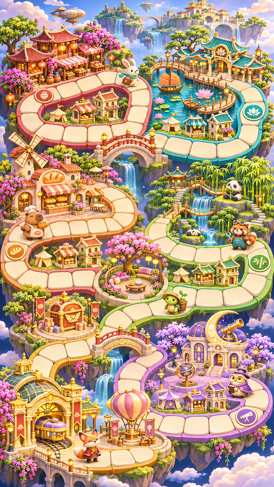
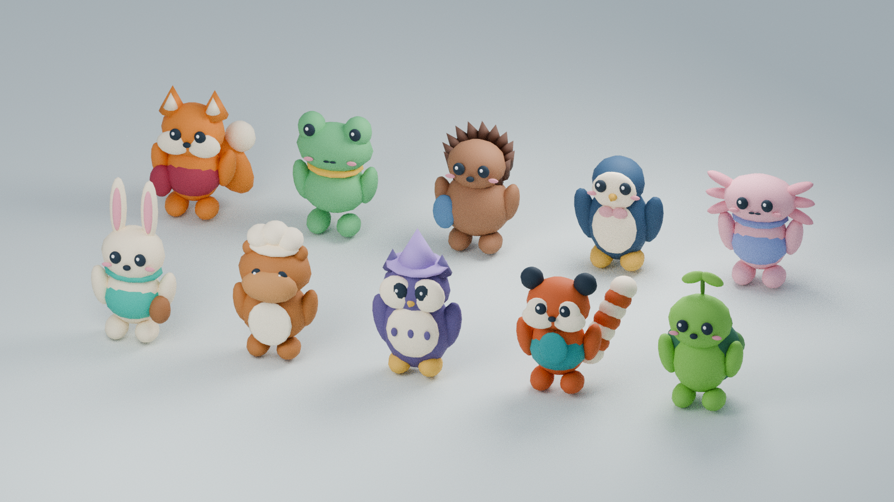

# Cờ tỷ phú — Bến Mây · Asset & Design

Bộ prototype cho game cờ tỷ phú dọc **9:16**: map, mascot, animation, âm thanh và kế hoạch. Chưa có mã game/server.

## Cờ Tý Phí TikTok LIVE · Sprite V2.3

[Bộ Sprite V2.3](assets/co-ty-phi-tiktok-live-v2/README.md) có 40 nhân vật, 1.108 atlas và đủ animation chó, mèo, chim sẻ, Bé Két MC. Xem [idle ba góc](assets/co-ty-phi-tiktok-live-v2/preview/Mit_Toc_Xu_V2_3_Idle_3_Huong.gif) và [đi bộ bốn hướng](assets/co-ty-phi-tiktok-live-v2/preview/Mit_Toc_Xu_V2_2_Di_Bo_4_Huong.gif).

## Cờ Tý Phí TikTok LIVE v1

[Bộ asset Phố Đồ Chơi](assets/co-ty-phi-tiktok-live-v1/README.md) gồm hai map GLB, 184 model rời, 20 nhân vật 2D chọn được, 20 NPC/thú cưng, UI, VFX và âm thanh. Mở [ảnh xem trước](assets/co-ty-phi-tiktok-live-v1/preview/Co_Ty_Phi_Preview.jpg) hoặc [bảng danh mục và tọa độ](assets/co-ty-phi-tiktok-live-v1/Danh_muc_va_toa_do_asset.xlsx).

## Bộ bàn giao

- [Nguồn, công cụ và các phần đang chặn](docs/co-ty-phu/00-sources-and-status.md)
- [Nghiên cứu và hướng sửa map](docs/co-ty-phu/01-map-study.md)
- [Quy cách nhân vật, animation, sprite và âm thanh](docs/co-ty-phu/02-asset-contract.md)
- [Kế hoạch logic / triển khai](docs/co-ty-phu/03-implementation-plan.md)
- [Kế hoạch 1 / 10 / 20 / 100 người](docs/co-ty-phu/04-scale-test-plan.md)
- [Báo cáo kiểm tra thực tế](docs/co-ty-phu/05-validation.json)
- [Danh sách model](assets/co-ty-phu/roster.json) · [Audio](assets/co-ty-phu/audio/manifest.json)
- [Preview walk từ GLB export/reimport](assets/co-ty-phu/previews/walk-preview.webm)
- [Map 3D tách lớp — Blender](assets/co-ty-phu/map/ben-may-blockout.blend) · [GLB](assets/co-ty-phu/map/ben-may-blockout.glb) · [Graph đề xuất](assets/co-ty-phu/map/layout.proposed.json)
- Ảnh bố trí token: [1](assets/co-ty-phu/previews/occupancy-001.png) / [10](assets/co-ty-phu/previews/occupancy-010.png) / [20](assets/co-ty-phu/previews/occupancy-020.png) / [100](assets/co-ty-phu/previews/occupancy-100.png)

Có 10 model GLB + file Blender nguồn, 40 animation, 480 frame sprite RGBA và 10 spritesheet, 12 SFX WAV nguyên bản. Các model là prototype hình học có thể chỉnh sửa; chưa phải final art khớp hoàn toàn concept.

Concept v02 là ảnh gộp gần 9:16; bản 3D đi kèm là blockout tách lớp với chu trình **40 ô minh họa**, chưa phải số ô đã chốt theo sheet. Bốn ảnh token là render bố trí tĩnh, không phải client mạng hoặc benchmark. V01 bị người dùng loại. Sheet thiết kế chưa đọc được do proxy 403; các đề xuất chưa được gán là yêu cầu từ sheet.

Đã dùng ImageGen gốc, Blender và công cụ cục bộ. **Chưa dùng được AutoSprite / Software Notion hoặc CLI Game Development Studio** vì phiên không cung cấp công cụ tương ứng. Chưa có đo hiệu năng game 100 người, engine import hoặc canonical package. Xem báo cáo để phân biệt việc đã chạy với kế hoạch.
