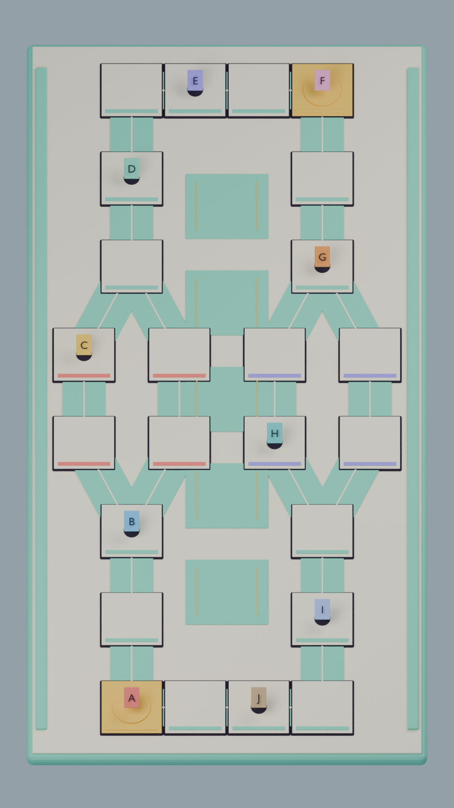
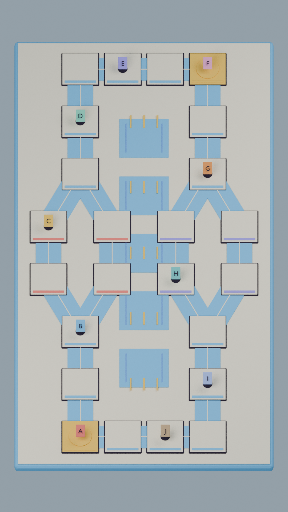

# Cờ Tý Phí TikTok LIVE — Map 10 ghế · 9:16

**Phạm vi hiện tại: chỉ dựng map. Người dùng tự tạo nhân vật, props, UI và âm thanh.**

Hai map 3D theo XLSX/DOCX tải lên: **Chợ Vỉa Hè** và **Phố Giao Hàng**. Mỗi map có 24 node, hai ga C00/C08, hai ngã rẽ F01/F02. Ảnh là render 1080×1920 từ hình học thật, có marker A–J minh họa 10 vị trí, không phải concept sinh ảnh.

## Xem map

### Chợ Vỉa Hè

### Phố Giao Hàng

## Tệp bàn giao

- [Chợ Vỉa Hè GLB](assets/map/cho_via_he.glb) · [nguồn Blender](assets/map/source/cho_via_he.blend)
- [Phố Giao Hàng GLB](assets/map/pho_giao_hang.glb) · [nguồn Blender](assets/map/source/pho_giao_hang.blend)
- [Graph, spawn, camera và collider đề xuất](assets/map/board_layouts.json)
- [Quy cách thay asset và điểm gắn](assets/map/README.md)
- [Báo cáo kiểm tra map](assets/map/validation.json)
- [Nguồn và đối chiếu phạm vi](docs/co-ty-phu/07-master-source-reconciliation.md)

Tọa độ đề xuất trong sheet được xoay/căn giữa và giãn dọc để hợp 9:16; giữ nguyên graph, độ rộng ô 2 wu và số bước. Các vị trí cũ/new đều giữ trong JSON. Không có nhân vật hay đạo cụ tự sản xuất trong GLB này; các slot chờ asset của người dùng. Marker A–J chỉ thuộc ảnh kiểm tra.

Các tệp ở `assets/co-ty-phu/` và tài liệu 01–06 là lịch sử prototype trước khi có nguồn; không tính chúng là map hiện hành. Chưa triển khai gameplay, mạng hoặc benchmark FPS.
