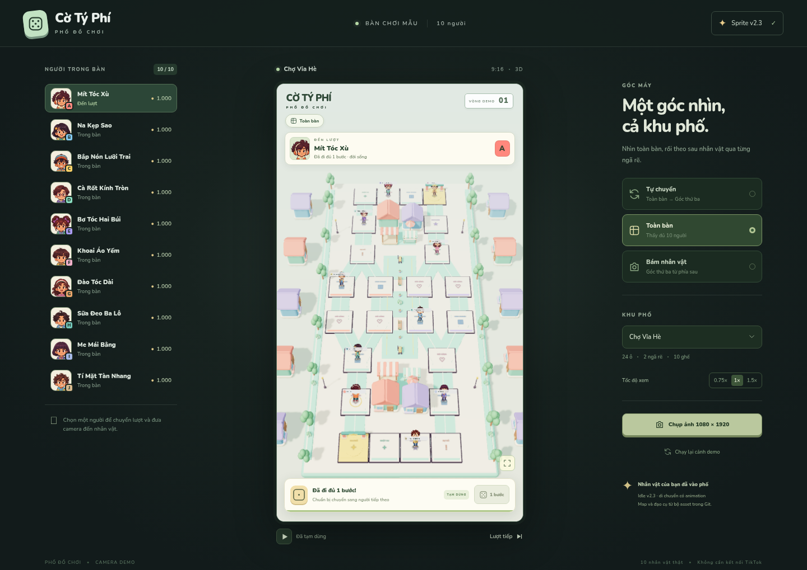

# Cờ Tý Phí — TikTok LIVE · Khu phố 3D

**Xem ngay:** [Demo 20 người tự chạy](http://127.0.0.1:5182/demo) · [Bản LIVE](http://127.0.0.1:5182/overlay) · [Quản lý](http://127.0.0.1:5182/admin). Demo dùng dữ liệu mô phỏng riêng; LIVE chỉ có người thật đã vào. Khung phát có top MONEY bên trái, quà bên phải và hai bài nhạc nền trong media.

Chạy `start-live.cmd`, bấm **Bật âm thanh** trong khung game để nghe MC và nhạc. [Hướng dẫn kết nối, MC, người mới và thay ghế](docs/co-ty-phu/14-live-studio.md). Server mặc định chưa kết nối TikTok; nhập username tại Admin khi phòng đã phát. Dừng bằng `stop-live.cmd` hoặc Ctrl+C.

**Tài liệu dùng để phát triển tiếp:** [Luật ván chơi và logic sự kiện V5](docs/co-ty-phu/13-event-logic-guide.md) — công thức tiền, lệnh, góp vốn/chart, shop, lì xì, ghép trận, MC và danh mục 50 thẻ.

**Bản local V5:** [hướng dẫn](web/LOCAL_PREVIEW.md) · [luật 20 quân và khách chờ](docs/co-ty-phu/12-community-and-100-racers.md) · [Excel V5](outputs/co-ty-phi-v5/Co_Ty_Phi_Su_Kien_V5.xlsx) · [MC JSON](assets/scripts/mc-v5.json). Mặc định **20 quân trên map, 100 tài khoản gồm 80 khách chờ**. Ba vòng đường, người thứ ba về đích chốt ván; hiện bục 8 giây rồi mở 15 giây giữ ghế. Tối đa 12 người cũ đầu tiên đạt 30 tim mới giữ ghế; ít nhất tám khách chờ lâu nhất lên khi đủ hàng. Suất giữ ghế dư cũng lấy FIFO; người cũ không giữ ghế nối cuối hàng. Khách chờ có ví và được đặt/hủy đơn SHOP01 miễn phí, góp vốn/chart và nhận lì xì, không sinh thêm sprite. Ván mới sinh map/đích và reset cả 100 ví về 1.000 MONEY. Chạy `start-local.cmd` hoặc `cd web` → `npm ci` → `npm run dev`, mở [bản 20 quân / 100 tài khoản](http://localhost:4173/?players=20&accounts=100). 100/200 quân chỉ là thử tải với `stress=1`; chưa nối adapter TikTok thật. Phần bên dưới giữ thông tin bản cũ.

Bản web 3D dọc 9:16 cho 10 nhân vật từ bộ sprite v2.3 trong Git. Camera tự chuyển từ nhìn toàn bàn sang góc thứ ba bám phía sau nhân vật, rồi lần lượt qua các ghế A–J.



[Xem góc thứ ba trên điện thoại](web/docs/third-person-mobile.png)

## Chạy bản web

```bash
cd web
npm ci
npm run dev
```

`npm run build` xuất website tĩnh vào `web/dist`; `npm run preview` mở bản build. [Hướng dẫn và điều khiển](web/README.md).

- Chuyển tự động / toàn bàn / bám nhân vật.
- Xúc xắc 3D quay, chốt ngẫu nhiên 1–6 rồi nhân vật đi đúng số ô; có nút **Lắc** và âm thanh từ bộ asset.
- Chọn một ghế, chuyển lượt, tạm dừng và đổi tốc độ xem.
- Đổi Chợ Vỉa Hè / Phố Giao Hàng.
- Nút chụp bản đồ 1080×1920.

## Asset thật được dùng

- Sprite V2.3: [assets/co-ty-phi-tiktok-live-v2](assets/co-ty-phi-tiktok-live-v2/README_V2_3.md), nguồn commit `fb996c6`.
- Nhà, cây, quầy, cổng và đạo cụ: [bộ môi trường v1](assets/co-ty-phi-tiktok-live-v1/README.md).
- Map và graph dọc: [assets/map](assets/map/README.md).

File gốc được giữ nguyên. Manifest crop/pivot/animation được đọc từ gói; sprite chạy theo quãng đường và đổi S/E/N/W theo hướng nhìn camera. Hướng sau dùng artwork quay lưng, không phải góc nhìn thứ nhất.

## Mở qua GitHub Pages

Nhánh `gh-pages` chứa bản build sẵn. Nếu Pages chưa bật, vào Settings → Pages → Deploy from a branch → gh-pages → /(root), rồi Save. URL dự kiến: `https://vietcodebug.github.io/C-_t-_Ph-_Tiktok_Live/`. Trạng thái bật site chưa xác nhận được từ cloud hiện tại; xem [deployment receipt](web/docs/deployment.json).

## Kiểm tra

[Browser smoke report](web/docs/browser-smoke.json): 18 kiểm tra đạt, gồm chuyển động/animation thật, camera thứ ba phía sau, chọn ghế, đổi map, pause, responsive 9:16 và xuất ảnh. Thử cả đường dẫn con như GitHub Pages. Không có lỗi ứng dụng hoặc request lỗi trong lần kiểm tra.

[Kiểm tra xúc xắc](web/docs/dice-browser.json) và `cd web && npm test` kiểm tra thứ tự quay → hiện kết quả → đi đúng số ô, cả hai nhánh đường và các mặt 1–6. [Ảnh xúc xắc trên màn hình dọc](web/docs/dice-result-mobile.png).

Đây là demo hình ảnh/camera, chưa phải game TikTok LIVE hoàn chỉnh. Chưa có backend kinh tế, chat/quà hoặc benchmark phần cứng phát LIVE. Prototype thú 3D/Bến Mây cũ không được dùng cho nhân vật của bản web.
